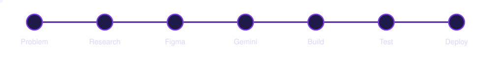
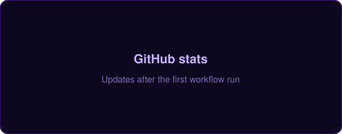
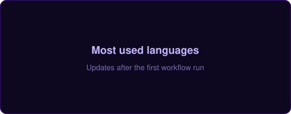

 

  

 

> **🟢 Open to:** UI/UX Designer, Generative AI and Software Developer internships, plus open-source collaborations.
> **Start here:** try the live apps in [Featured Projects](#-featured-projects), browse my [UI/UX work](#-uiux-design-work), or open the [SafeSphere Figma prototype](https://www.figma.com/design/eykfa4yw6cHiMVMLdB3Ldu/SafeSphere?node-id=0-1&p=f&t=G7FptzOCmZcLlSX4-0).

## 👩‍💻 About Me

I'm a **2nd-year B.E. Computer Science student** at **Easwari Engineering College (SRM Group)**. I turn real-world problems into products people actually use, working across **AI integration and prompt engineering, backend APIs, mobile and web front-ends, and Figma design**.

Across three remote internships I've shipped **deployed apps and design prototypes** in agriculture, animal welfare, developer tooling and community safety.

| | |
|:--|:--|
| 🔭 **Now building** | Multimodal AI agents with **Gemini API**, **Flutter** and **Flask** |
| 🎨 **Now designing** | Figma wireframes, prototypes and design systems with a focus on visual hierarchy and accessibility |
| 🎯 **Looking for** | UI/UX Designer, Generative AI and Software Developer internships, open-source collaborations |
| 🌱 **Driven by** | Social-impact tech, sustainability, clean and accessible interfaces |
| 💬 **Ask me about** | Gemini integration, prompt engineering, Flutter, Flask, Figma |
| 🎓 **Education** | B.E. CSE (2025 - 2029) · **CGPA 9.45 / 10** · HSC **95%** (School Topper) · SSLC 93% |
| 🗣️ **Languages** | English (Fluent), Tamil (Native) |

## 🛠️ Tech Stack

| Category | Stack |
|:--|:--|
| **Languages** | `Python` `JavaScript` `Dart` `Java` `C` |
| **AI & GenAI** | `Google Gemini API` `Generative AI` `Prompt Engineering` `Multimodal AI` `API Integration` |
| **Web & Mobile** | `Flutter` `Flask` `Bootstrap 5` `HTML5` `CSS3` |
| **Data & Maps** | `Chart.js` `Leaflet.js` |
| **UI/UX Design** | `Figma` `Wireframing (Balsamiq)` `Prototyping` `Illustrator` `Adobe Express` |
| **Tools & Deploy** | `Git` `GitHub` `Render` `Netlify` |

## 🚀 Featured Projects

<table>
<tr>
<td width="50%" valign="top">

### 🌾 Digital Krishi Officer
**AI farmer query support and advisory system**

A mobile-first AgriTech companion giving farmers 24/7 advice through a multimodal, dialect-aware Gemini chatbot that understands text, crop-leaf photos and field videos.

- Replies in Tamil, Hindi, English and Tanglish
- Leaf disease detection with remedy cards
- Voice-first text-to-speech playback
- Live APMC mandi price tracking with trend indicators
- Hyperlocal weather advisories, layouts down to 320px
- **29/29** automated tests passing

`Flutter` `Dart` `Gemini API` `Provider` `Flutter TTS`

**[▶ Live Demo](https://digital-krishi-officer-a647.onrender.com)**

</td>
<td width="50%" valign="top">

### 🐾 PawConnect AI & PawBot
**Stray animal rescue coordination platform**

A full-stack platform for stray-dog incident reporting and volunteer rescue coordination, built in the 1M1B x IBM SkillsBuild x AICTE internship.

- PawBot: AI assistant for animal emergency guidance
- Admin dashboard with real-time analytics (Chart.js)
- Incident geolocation maps (Leaflet.js)
- Deployed live on Render

`Python` `Flask` `Bootstrap 5` `Chart.js` `Leaflet.js`

**[▶ Live Demo](https://pawconnect-ai-powered-dpe8.onrender.com)**

</td>
</tr>
<tr>
<td width="50%" valign="top">

### 🔍 GitHub Portfolio Analyzer
**AI-powered developer profile evaluator**

Analyzes a GitHub profile via the GitHub REST API and generates tailored improvement recommendations using prompt engineering. Built during my Generative AI and Prompt Engineering internship at Tamizhan Skills.

- Repository and language insights
- Prompt-engineered recommendation engine
- Clean, responsive interface

`JavaScript` `Generative AI` `HTML5` `CSS3` `GitHub API`

**[▶ Live Demo](https://github-portfolio-analyzer-r0zy.onrender.com)**

</td>
<td width="50%" valign="top">

### 🛡️ SafeSphere
**Community safety mobile app (UI/UX)**

A complete mobile app design: onboarding, incident reporting, live map tracking, one-tap emergency SOS, alerts and profile settings, delivered as an interactive Figma prototype.

- End-to-end product design
- Reusable components and design system
- Wireframing and prototyping

`Figma` `UI/UX` `Design System` `Prototyping`

**[▶ Figma Prototype](https://www.figma.com/design/eykfa4yw6cHiMVMLdB3Ldu/SafeSphere?node-id=0-1&p=f&t=G7FptzOCmZcLlSX4-0)**

</td>
</tr>
</table>

## 🎨 UI/UX Design Work

<b>What I designed during my Thiranex UI/UX internship</b>

 

- **Community volunteering app:** low-fidelity wireframe covering login, home, volunteering opportunities, volunteer profile and community posts.
- **Nike website redesign:** focused on visual hierarchy, typography, colour consistency and responsive desktop and mobile layouts.
- **Fresh Fruits app:** interactive prototype with clickable navigation, transitions and a smooth user journey.

## 🧭 How I Build

## 💼 Experience

## 🏆 Honors & Achievements

- 🥉 **3rd Place and Top 10 Finalist, Prompt Run 2026**: Frontend Arena hackathon on Unstop, score **96.7 / 100** (Credential ID `FA-3KQA7WD4`)
- 🎓 **IBM SkillsBuild and AICTE** partnered sustainability AI internship (via 1M1B)
- 🎨 **UI/UX Design Office Bearer**, F.A.B.R.I.C.
- 💡 **Winner**, multiple IoT tech expos and college-level innovation competitions
- 📜 **Government-certified** in Typewriting (English) and Hindi (Rashtrabhasha Prarangik / Parichay 1)
- 🎖️ **School Topper**, HSC board exams (SSLC 93% · HSC 95%)
- 📚 **CGPA 9.45 / 10** at Easwari Engineering College

## 📊 GitHub Activity

 

  

## 🎯 Currently

- 🧠 Levelling up multimodal AI agents and prompt design patterns
- 📱 Polishing Flutter apps for accessibility and low-end devices
- 🎨 Growing Figma design-system skills toward production-ready UI/UX
- 🤝 Seeking UI/UX Designer internships and open-source projects where design and AI meet

 

*If you're building something with impact, I'd love to help design it, prompt it or ship it.*

 

